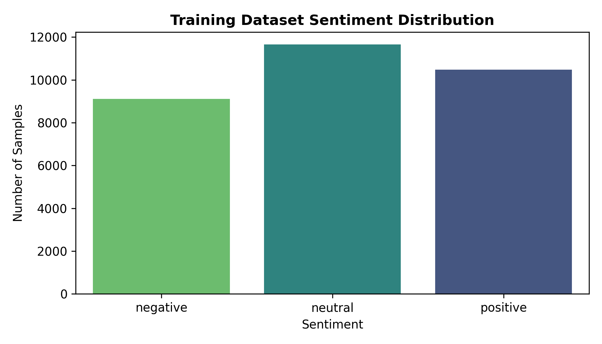
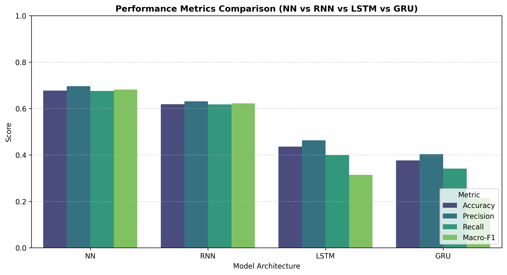
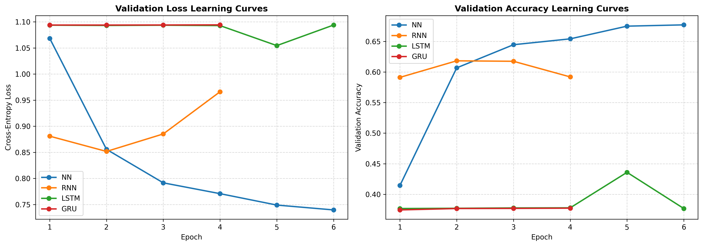
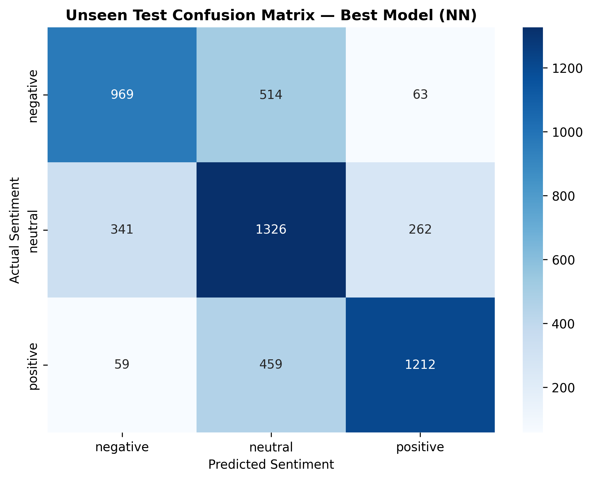

# Multi-Class Sentiment Analysis: Comparing NN, RNN, LSTM, and GRU

## 📌 Project Overview
Built, automatically tuned, and compared **Feedforward Neural Network (NN)**, **Simple RNN**, **LSTM**, and **GRU** architectures on the Hugging Face `Sp1786/multiclass-sentiment-analysis-dataset` using **TensorFlow, Keras, and Keras Tuner**.

## 📊 Dataset Distribution

## 🏆 Validation Model Comparison
| Model   |   Accuracy |   Precision |   Recall |   Macro-F1 |   Validation Loss |   Best Epoch |   Training Time (s) |
|:--------|-----------:|------------:|---------:|-----------:|------------------:|-------------:|--------------------:|
| NN      |     0.677  |      0.6959 |   0.6755 |     0.6819 |            0.7396 |            6 |               13.31 |
| RNN     |     0.6183 |      0.6312 |   0.6181 |     0.6219 |            0.8517 |            2 |                9.89 |
| LSTM    |     0.4359 |      0.4632 |   0.3999 |     0.3142 |            1.0545 |            5 |               19.82 |
| GRU     |     0.3768 |      0.4034 |   0.341  |     0.2129 |            1.0939 |            2 |                9.28 |

### Performance Metrics & Learning Curves

## 🧪 Unseen Test Set Evaluation (Winning Model: NN)
* **Best Model:** `NN`
* **Best Hyperparameters:** `{'embedding_dim': 128, 'hidden_dim': 128, 'num_layers': 2, 'dropout': 0.2, 'learning_rate': 0.0005}`
* **Test Accuracy:** `67.38%`
* **Test Macro-F1:** `0.6780`
* **Test Loss:** `0.7458`

